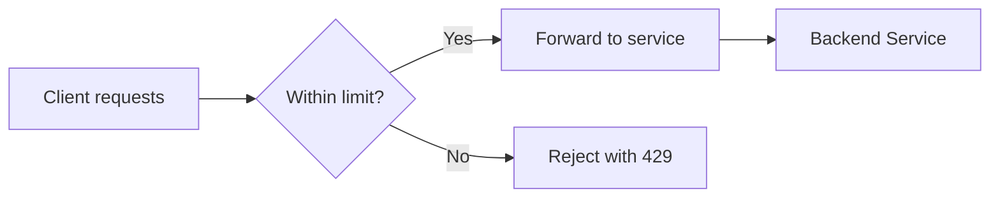
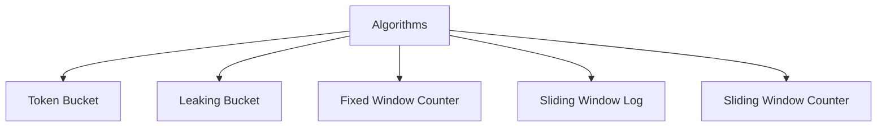
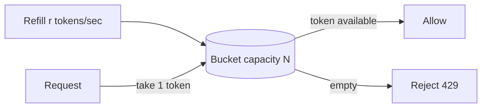
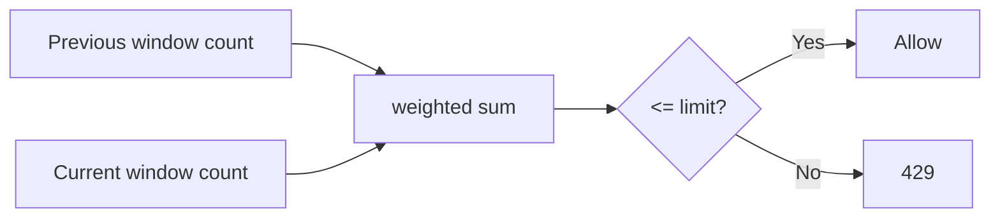
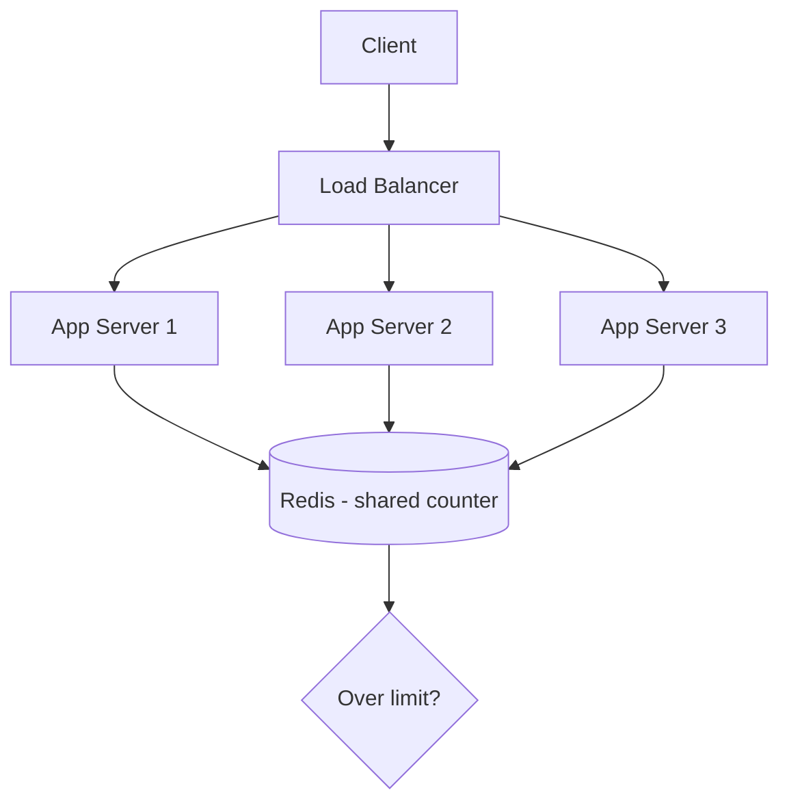
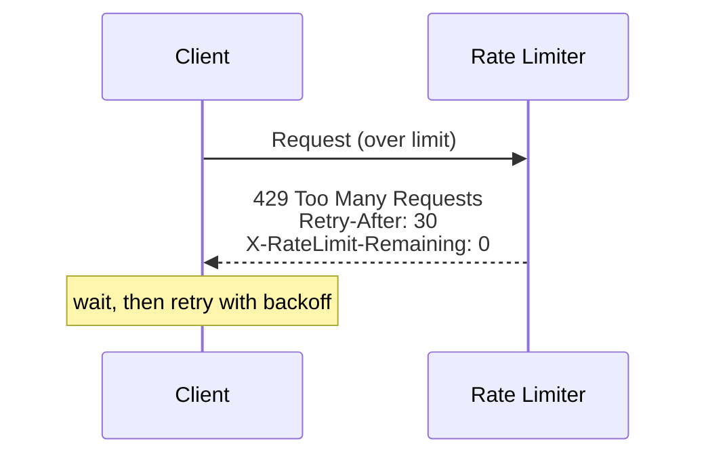
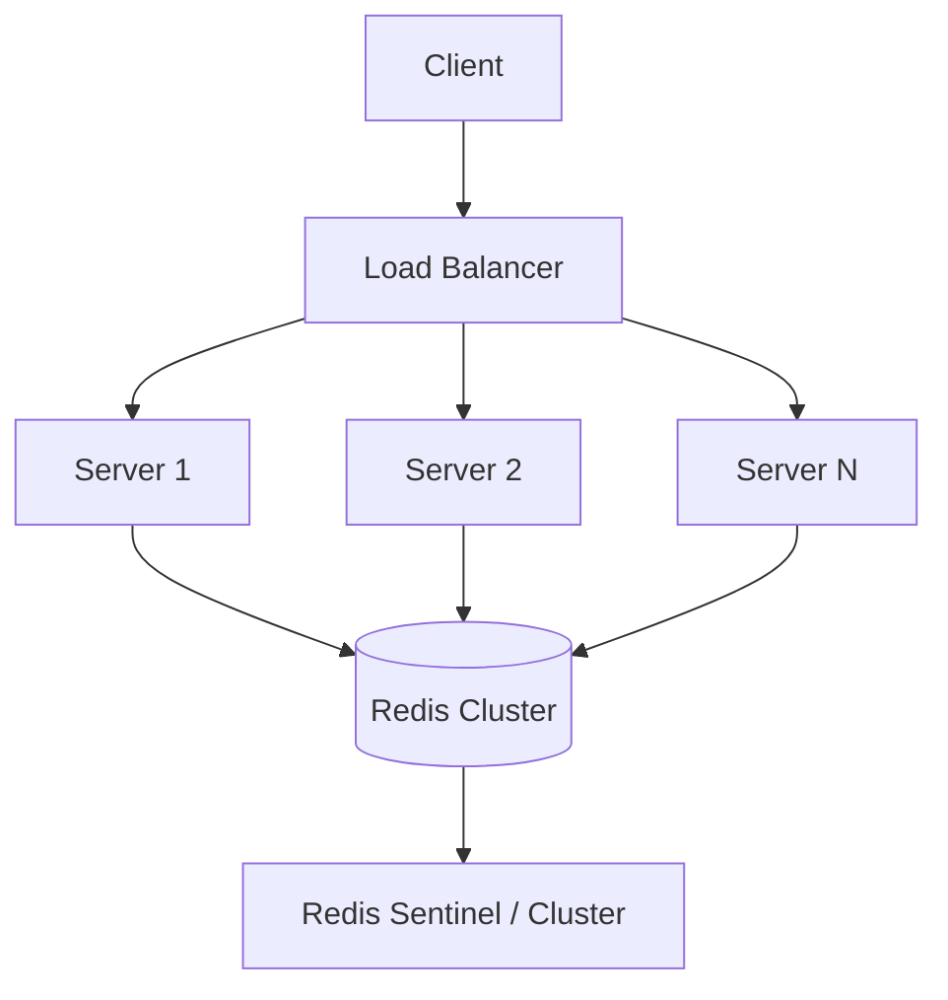

<span id="rate-limiting"></span>

# Rate Limiting

Control fairness, admission, bursts, and counter failures.

**Prerequisite / previous:** [Service Discovery](service-discovery.md) · **Next:** [Message Queues](message-queues.md)


Rate limiting controls how much work a caller can request. For example, an API may allow 100 requests per minute. Define how requests are counted, whether short bursts are allowed, and what the caller should do after a rejection.

---

## Follow the task app

A school printer may allow each student a fixed number of pages. The task API can similarly limit repeated requests so one client cannot use all the available capacity.

1. Choose an action, such as creating a task.
2. Choose the account or key whose requests are counted.
3. Apply the counting rule and explain rejections.
4. Try requests around a time boundary and through more than one server.

## Words to know

| Word | Meaning |
| --- | --- |
| Quota | An allowed amount of work. |
| Burst | Many requests arriving close together. |
| Backoff | Waiting before trying again after a failure or rejection. |

## Core Concepts — Why Rate Limit?

Without limits, a single client (buggy loop, scraper, or attacker) can exhaust your capacity and degrade service for everyone. **Rate limiting** enforces a quota per client, endpoint, or API key.

**Why it matters:**

- **Prevent abuse & DoS** — block brute-force logins and floods.
- **Ensure fairness** — no single tenant starves others.
- **Control cost** — cap usage of expensive downstream calls (e.g., paid APIs, LLMs).
- **Protect stability** — shed excess load before it topples the system.



---

## Rate Limiting Algorithms

Each algorithm trades memory, accuracy, and burst behavior differently.



### Token Bucket

A bucket holds up to _N_ tokens and refills at a steady rate. Each request consumes one token; if the bucket is empty, the request is rejected. **Allows short bursts** (up to bucket size) while enforcing an average rate. Widely used (e.g., API gateways, AWS).



### Leaking Bucket

Requests enter a queue (bucket) and are processed ("leak") at a **fixed constant rate**. Smooths bursts into a steady output stream. Great when the downstream needs a stable rate; excess overflows and is dropped.

### Fixed Window Counter

Count requests per fixed interval (e.g., 100/min). Simple and memory-cheap, but suffers the **boundary burst problem**: a client can send 100 at 0:59 and 100 at 1:00 — 200 in ~2 seconds.

### Sliding Window Log

Store a timestamp for every request and count those within the trailing window. Exact for its defined clock and atomic-update contract, but memory grows with request volume — expensive at scale.

### Sliding Window Counter

A hybrid: combines the current and previous fixed-window counts, weighted by how far into the current window we are. **Approximates** the sliding log with tiny memory — the popular production sweet spot.



| Algorithm           | Bursts          | Accuracy      | Memory          | Notes                    |
| ------------------- | --------------- | ------------- | --------------- | ------------------------ |
| **Token Bucket**    | Allows bursts   | Good          | Low             | Average rate + burst cap |
| **Leaking Bucket**  | Smooths bursts  | Good          | Low–med (queue) | Constant output rate     |
| **Fixed Window**    | Boundary bursts | Low           | Very low        | Simplest                 |
| **Sliding Log**     | Up to the window quota at once       | Exact         | High            | Costly at scale          |
| **Sliding Counter** | Minimal         | High (approx) | Low             | Best general choice      |

---

## Distributed Rate Limiting

With many app servers behind a [load balancer](load-balancing.md), each instance seeing only its own traffic can't enforce a global limit. A strict shared quota can use a **shared, fast store** — typically Redis (see [Caching](../data/caching.md)) — so all instances share one source of truth.



- **Atomicity** — use atomic ops (Redis `INCR`/Lua scripts) so concurrent updates don't race.
- **Latency vs. accuracy** — a central store is accurate but adds a network hop; some systems allow small per-node quotas for speed and reconcile centrally.
- **Consistency** — relates to broader trade-offs in [Consistency Models](../distributed/consistency-models.md).

---

## Where to Place Rate Limiting


- **Edge / CDN** — stops floods before they reach your infrastructure.
- **API Gateway / L7 [load balancer](load-balancing.md)** — the most common place; centralized policy per API key/route (see [API Design](../interfaces/api-design.md)).
- **Within a service / [microservice](microservices.md)** — fine-grained, business-aware limits (e.g., per-user-tier quotas).

> **Rule of thumb**: limit as early (close to the edge) as possible to save resources, but add finer per-user/per-endpoint limits deeper in where business context lives.

---

## Response Handling (HTTP 429)

When a client exceeds the limit, return **`429 Too Many Requests`** with headers so well-behaved clients can back off:

- `Retry-After: 30` — seconds to wait before retrying.
- `X-RateLimit-Limit` — the ceiling for the window.
- `X-RateLimit-Remaining` — requests left in the current window.
- `X-RateLimit-Reset` — when the window resets.



> **Client best practice**: honor `Retry-After` and use **exponential backoff with jitter** to avoid synchronized retry storms.

---

## Trade-offs / When to Use

- **Accuracy vs. cost.** Sliding-window-log is exact but memory-heavy; sliding-window-counter or token bucket give near-exact results cheaply — preferred for most APIs.
- **Burst tolerance.** Token bucket permits bursts (good UX); leaking bucket enforces a strict smooth rate (protects fragile downstreams).
- **Local vs. distributed.** Per-node limiting is fast but inaccurate globally; a shared store is accurate but adds latency and a dependency.
- **Fail open vs. fail closed.** If the rate-limit store is down, decide whether to allow traffic (availability) or block it (protection) — a classic availability-vs-safety choice.
- **Don't over-restrict.** Aggressive limits harm legitimate users; tune with real traffic data and offer higher tiers where appropriate.

---


## Interview Questions (expanded answers)

### When would you choose a distributed token bucket vs per-node local quotas?

- Distributed token bucket: choose when you need precise global quotas (tenant-level rate limits) and when fairness is critical. Requires a shared store (Redis, Cloud provider) and atomic operations.
- Per-node local quotas: choose when per-request latency must be minimal and a small, bounded inaccuracy is acceptable. Combine with periodic central reconciliation or soft limits to maintain fairness.

Hybrid approach: allow small local bursts (local tokens) and periodically reconcile or check central counters for sustained enforcement.

### How do you implement a global rate limiter with low latency and acceptable accuracy?

Pattern options:
- Centralized accurate limiter: Redis Lua scripts (INCR + TTL), atomic counters, single source-of-truth — accurate but adds a network hop.
- Edge-first approach: enforce coarse limits at CDN/edge, refine at API gateway with central store for strict quotas.
- Approximate/local caches: grant local permits for short windows, then check central store for long-lived enforcement.

Key practices: use atomic operations, add metrics for false positives/negatives, and cache decisions briefly to reduce central load.

### Describe the client and server behavior when throttled — how should SDKs politely back off?

Server behavior:
- Return 429 Too Many Requests with Retry-After, X-RateLimit-* headers and an explanatory body.
- Optionally include a quota window expiry or suggested retry delay.

Client/SDK behavior:
- Honor Retry-After when present; otherwise use exponential backoff with jitter.
- Mark non-idempotent operations with idempotency keys so safe retries are possible.
- Surface rate-limit metrics to telemetry so operators can tune policies.

## Production Checklist

- Monitor global and per-key request rates, latency, and 429 metrics
- Implement and test DLQ-like behavior for excessive clients (e.g., blocking or blacklisting)
- Ensure Redis (or chosen store) is highly available and instrumented when used for counters
- Provide clear client-facing headers and documented retry semantics
- Publish SDK guidance: retry with exponential backoff + jitter and respect Retry-After

## Testing & Monitoring

- Load test under bursty and steady high-load patterns and measure false positives/negatives
- Test fail-open vs fail-closed behavior of the limiter when the shared store is unavailable
- Verify correct operation across multiple regions and with CDNs at the edge
- Simulate latency-sensitive endpoints to validate early rejection and edge-rate limiting

## Related Topics

- [Load Balancing](load-balancing.md) — the L7 gateway is the usual enforcement point
- [Caching](../data/caching.md) — Redis as the shared counter store
- [Microservices](microservices.md) — per-service and per-tenant limits
- [API Design](../interfaces/api-design.md) — quota policies, keys, and 429 semantics
- [Consistency Models](../distributed/consistency-models.md) — accuracy trade-offs of distributed counters
- [Scalability](../foundations/capacity.md) — rate limiting protects capacity under load
- [Heap](../../DSA/heap/README.md) — priority queues used in scheduling/limiters

---


## Worked quota and outage policy

A token bucket with capacity 100 and refill rate 10 tokens/s allows a burst of 100 unit-cost requests when full, then about 10 requests/s over time. If 20 gateways each maintain an independent full bucket for the same tenant, the aggregate allowance can be 20 times the intended budget. A shared atomic counter enforces a tighter quota but adds dependency latency; partitioned quota leases trade precision for availability.

Count expensive requests by cost where practical, and distinguish a rate budget from a concurrency limit. Ten slow requests can exhaust ten workers even when the rate looks low. Define a bounded wait and rejection response; honor `Retry-After` without synchronizing all clients into a retry spike.

**Failure mode:** the limiter is unavailable. A low-risk read path may use a conservative local budget; an expensive or sensitive action may reject. Choose and test the policy explicitly. **Exercise:** send a burst at a window boundary, then take down the quota store. **Check:** measure accepted work across all gateways and explain overshoot, fairness, and recovery. Never assume rate limiting alone prevents a distributed denial-of-service attack.

## Implementation details

### Rate Limiting in Express

#### express-rate-limit

[`express-rate-limit`](https://www.npmjs.com/package/express-rate-limit) is the most popular rate limiting middleware for Express. It uses a **fixed window** counter in memory by default.

```bash
npm install express-rate-limit
```

**Basic usage:**

```javascript
const express = require('express');
const rateLimit = require('express-rate-limit');

const app = express();

// Global rate limiter: 100 requests per 15 minutes per IP
const globalLimiter = rateLimit({
  windowMs: 15 * 60 * 1000, // 15 minutes
  max: 100, // limit each IP to 100 requests per windowMs
  standardHeaders: true, // Return rate limit info in the `RateLimit-*` headers
  legacyHeaders: false, // Disable the `X-RateLimit-*` headers
  message: {
    error: {
      code: 'RATE_LIMITED',
      message: 'Too many requests, please try again later.',
    },
  },
});

// Apply to all routes
app.use(globalLimiter);

app.get('/api/health', (req, res) => {
  res.json({ status: 'ok' });
});

app.listen(3000, () => console.log('Server running on port 3000'));
```

**Route-specific limiters:**

```javascript
// Strict limiter for authentication routes
const authLimiter = rateLimit({
  windowMs: 15 * 60 * 1000,
  max: 5, // 5 attempts per 15 min
  skipSuccessfulRequests: false,
  message: { error: { code: 'TOO_MANY_ATTEMPTS', message: 'Too many login attempts' } },
});

app.post('/api/login', authLimiter, (req, res) => {
  // login logic
});

// Moderate limiter for general API
const apiLimiter = rateLimit({
  windowMs: 60 * 1000, // 1 minute
  max: 60, // 60 requests per minute
});

app.use('/api/', apiLimiter);
```

**Custom key generator (e.g., by user ID or API key):**

```javascript
const userLimiter = rateLimit({
  windowMs: 60 * 1000,
  max: 100,
  keyGenerator: (req) => {
    // Rate limit by authenticated user ID, fallback to IP
    return req.user?.id || req.ip;
  },
});
```

**Using external stores (Redis, Memcached):**

```javascript
const RedisStore = require('rate-limit-redis');
const Redis = require('ioredis');

const redisClient = new Redis({ host: 'localhost', port: 6379 });

const limiter = rateLimit({
  windowMs: 60 * 1000,
  max: 1000,
  store: new RedisStore({
    // @ts-ignore — known typing issue with sendCommand
    sendCommand: (...args) => redisClient.call(...args),
  }),
});
```

---

#### rate-limiter-flexible

[`rate-limiter-flexible`](https://www.npmjs.com/package/rate-limiter-flexible) is a more advanced library supporting multiple algorithms (token bucket, sliding window, fixed window), multiple backends (Redis, MongoDB, MySQL, PostgreSQL, in-memory), and atomic operations.

```bash
npm install rate-limiter-flexible
```

**Why choose it over express-rate-limit:**

- Supports **Token Bucket** (with burst) and **Sliding Window** out of the box
- Atomic operations — safe for distributed/multi-process deployments even without Redis
- Built-in **block** duration (penalty box for abusers)
- In-memory **queues** with configurable max queue size
- **Insurance** mode — retry rejected promises after a delay

**Basic token bucket limiter:**

```javascript
const { RateLimiterMemory } = require('rate-limiter-flexible');

// Token bucket: 100 points, refill 2 points/sec (sustained 2 req/s, burst 100)
const opts = {
  points: 100, // max requests
  duration: 1, // per second (points + duration define refill rate)
  blockDuration: 0, // don't block, just reject
};

const rateLimiter = new RateLimiterMemory(opts);

app.use(async (req, res, next) => {
  try {
    const rateLimiterRes = await rateLimiter.consume(req.ip);
    // Allowed — attach rate limit info to response
    res.setHeader('Retry-After', rateLimiterRes.msBeforeNext / 1000);
    res.setHeader('X-RateLimit-Limit', opts.points);
    res.setHeader('X-RateLimit-Remaining', rateLimiterRes.remainingPoints);
    res.setHeader(
      'X-RateLimit-Reset',
      new Date(Date.now() + rateLimiterRes.msBeforeNext).toISOString(),
    );
    next();
  } catch (rejRes) {
    // Rejected
    res.setHeader('Retry-After', rejRes.msBeforeNext / 1000);
    res.status(429).json({
      error: {
        code: 'RATE_LIMITED',
        message: `Too many requests. Retry after ${Math.ceil(rejRes.msBeforeNext / 1000)}s`,
      },
    });
  }
});
```

**Sliding window with rate-limiter-flexible:**

```javascript
const { RateLimiterRedis } = require('rate-limiter-flexible');
const Redis = require('ioredis');

const redisClient = new Redis({ host: 'localhost', port: 6379 });

// Sliding window: 100 requests per 60 seconds, accurate to the request
const slidingWindowLimiter = new RateLimiterRedis({
  storeClient: redisClient,
  points: 100,
  duration: 60,
  execEvenly: false, // false = allow bursts within the window
  keyPrefix: 'rl:sw:', // Redis key prefix
  blockDuration: 120, // Block for 2 min if limit exceeded consecutively
});
```

**Penalty box / blocking repeat offenders:**

```javascript
const strictLimiter = new RateLimiterRedis({
  storeClient: redisClient,
  points: 5, // 5 requests
  duration: 1, // per second
  blockDuration: 60 * 5, // Block for 5 minutes if repeatedly exceeded
  inmemoryBlockOnConsumed: 10, // Track top 10 blocked keys in memory
});
```

**Advanced: In-memory queue (wait if busy):**

```javascript
const { RateLimiterQueue } = require('rate-limiter-flexible');

const limiter = new RateLimiterMemory({
  points: 10,
  duration: 1,
});

const queue = new RateLimiterQueue(limiter, {
  maxQueueSize: 100, // Reject if > 100 waiting
});

async function handleRequest(req, res) {
  try {
    const remainingTokens = await queue.removeTokens(1);
    // Process request — it may have waited if tokens weren't available
    res.json({ success: true });
  } catch (err) {
    // Queue full or limiter rejected
    res.status(429).json({ error: 'Rate limited' });
  }
}
```

---


### Distributed Rate Limiting with Redis

In a multi-process or multi-server deployment, in-memory rate limiters don't work — each instance has its own counters. Redis provides a centralized state store that all instances share.

#### Why Redis?

- **Atomic operations**: `INCR`, `EXPIRE`, sorted set commands are atomic
- **Lua scripting**: Run complex logic atomically in a single round-trip
- **Persistence**: Optional RDB/AOF for durability across restarts
- **Low latency**: Sub-millisecond operations in typical deployments
- **Data structures**: Sorted sets for sliding window, hashes for bucket state, strings for counters

#### Architecture



---

#### Fixed Window with Redis (Lua Script)

This Lua script atomically increments a counter and sets a TTL (time-to-live) if the key doesn't exist. The `EXPIRE` is set only on first creation to avoid extending the window on every request.

```lua
-- fixed_window.lua
-- KEYS[1]: rate limit key (e.g., "rl:192.168.1.1")
-- ARGV[1]: limit (max requests)
-- ARGV[2]: window in seconds (TTL)

local current = redis.call('INCR', KEYS[1])
if current == 1 then
    -- First request in the window — set expiration
    redis.call('EXPIRE', KEYS[1], ARGV[2])
end

if current > tonumber(ARGV[1]) then
    -- Rate limited
    local ttl = redis.call('TTL', KEYS[1])
    if ttl < 0 then ttl = tonumber(ARGV[2]) end
    return {0, ttl}  -- {allowed=0, ttl}
end

return {1, 0}  -- {allowed=1}
```

**Node.js usage:**

```javascript
const Redis = require('ioredis');
const redis = new Redis();

const FIXED_WINDOW_SCRIPT = `
local current = redis.call('INCR', KEYS[1])
if current == 1 then
    redis.call('EXPIRE', KEYS[1], ARGV[2])
end
if current > tonumber(ARGV[1]) then
    local ttl = redis.call('TTL', KEYS[1])
    if ttl < 0 then ttl = tonumber(ARGV[2]) end
    return {0, ttl}
end
return {1, 0}
`;

async function fixedWindowRateLimit(key, limit, windowSec) {
  const [allowed, ttl] = await redis.eval(
    FIXED_WINDOW_SCRIPT,
    1, // number of keys
    key, // KEYS[1]
    limit, // ARGV[1]
    windowSec, // ARGV[2]
  );
  return { allowed: allowed === 1, retryAfter: ttl };
}
```

---

#### Sliding Window with Redis Sorted Sets (Lua Script)

Uses a Redis sorted set where the **score** is the timestamp. Each request adds a member with a unique ID and timestamp score. Before adding, expired members (outside the window) are removed. Then the count of remaining members is checked against the limit.

```lua
-- sliding_window.lua
-- KEYS[1]: sorted set key
-- ARGV[1]: current timestamp (milliseconds)
-- ARGV[2]: window in milliseconds
-- ARGV[3]: limit
-- ARGV[4]: unique member ID (timestamp + random for uniqueness)

-- Remove expired entries (older than window)
redis.call('ZREMRANGEBYSCORE', KEYS[1], 0, tonumber(ARGV[1]) - tonumber(ARGV[2]))

-- Count requests in the current window
local count = redis.call('ZCARD', KEYS[1])

if count >= tonumber(ARGV[3]) then
    -- Find the oldest entry for Retry-After
    local oldest = redis.call('ZRANGE', KEYS[1], 0, 0, 'WITHSCORES')
    local retryAfter = 0
    if #oldest > 0 then
        retryAfter = math.ceil((tonumber(oldest[2]) + tonumber(ARGV[2]) - tonumber(ARGV[1])) / 1000)
        if retryAfter < 0 then retryAfter = 0 end
    end
    return {0, retryAfter}
end

-- Add current request
redis.call('ZADD', KEYS[1], ARGV[1], ARGV[4])
-- Set expiration on the key itself
redis.call('PEXPIRE', KEYS[1], ARGV[2])

return {1, 0}
```

**Node.js usage:**

```javascript
const crypto = require('crypto');

const SLIDING_WINDOW_SCRIPT = `...`; // Lua script from above

async function slidingWindowRateLimit(key, limit, windowMs) {
  const now = Date.now();
  const memberId = `${now}-${crypto.randomBytes(4).toString('hex')}`;

  const [allowed, retryAfter] = await redis.eval(
    SLIDING_WINDOW_SCRIPT,
    1,
    key, // KEYS[1]
    now, // ARGV[1]
    windowMs, // ARGV[2]
    limit, // ARGV[3]
    memberId, // ARGV[4]
  );
  return { allowed: allowed === 1, retryAfter };
}
```

---

#### Token Bucket with Redis (Lua Script)

Stores bucket state as a Redis hash: `{ tokens, lastRefill }`. The Lua script calculates refill, consumes a token if available, and returns updated state — all atomically.

```lua
-- token_bucket.lua
-- KEYS[1]: bucket key
-- ARGV[1]: capacity (max tokens)
-- ARGV[2]: refill rate (tokens per second)
-- ARGV[3]: tokens to consume (usually 1)
-- ARGV[4]: current time in seconds (with decimal)

local bucket = redis.call('HMGET', KEYS[1], 'tokens', 'lastRefill')
local tokens = tonumber(bucket[1])
local lastRefill = tonumber(bucket[2])
local now = tonumber(ARGV[4])
local capacity = tonumber(ARGV[1])
local refillRate = tonumber(ARGV[2])
local consume = tonumber(ARGV[3])

if tokens == nil then
    -- First request — initialize full bucket
    tokens = capacity
    lastRefill = now
end

-- Refill
local elapsed = now - lastRefill
tokens = math.min(capacity, tokens + elapsed * refillRate)
lastRefill = now

local allowed = 0
if tokens >= consume then
    tokens = tokens - consume
    allowed = 1
end

-- Store updated state
redis.call('HMSET', KEYS[1], 'tokens', tokens, 'lastRefill', lastRefill)
redis.call('EXPIRE', KEYS[1], math.ceil(capacity / refillRate) + 60)

local retryAfter = 0
if allowed == 0 then
    retryAfter = math.ceil((consume - tokens) / refillRate)
end

return {allowed, retryAfter, tokens}
```

---

#### Production Redis Configuration

```javascript
const Redis = require('ioredis');

// For high-availability, use Redis Sentinel or Cluster
const redis = new Redis.Cluster(
  [
    { host: 'redis-node-1', port: 6379 },
    { host: 'redis-node-2', port: 6379 },
    { host: 'redis-node-3', port: 6379 },
  ],
  {
    redisOptions: {
      password: process.env.REDIS_PASSWORD,
      enableOfflineQueue: false, // Fail fast if Redis is unreachable
      maxRetriesPerRequest: 1, // Quick failure for rate limiter operations
      connectTimeout: 500, // 500ms connection timeout
    },
  },
);

// Fallback: if Redis is down, allow requests (fail-open) or reject (fail-closed)
async function rateLimitWithFallback(key, limit, windowMs) {
  try {
    return await slidingWindowRateLimit(key, limit, windowMs);
  } catch (err) {
    console.error('Redis rate limiter error:', err.message);
    // Fail-open: allow the request (prefer availability over protection)
    // OR fail-closed: reject the request (prefer protection over availability)
    return { allowed: true, degraded: true };
    // For mission-critical protection: return { allowed: false, degraded: true };
  }
}
```

---


### Rate Limit HTTP Headers

Standardized headers let clients understand their current quota and adjust behavior accordingly. These headers are defined by the IETF draft [RateLimit Header Fields for HTTP](https://datatracker.ietf.org/doc/draft-ietf-httpapi-ratelimit-headers/).

#### Standard Headers (RFC draft)

| Header                | Description                              | Example    |
| --------------------- | ---------------------------------------- | ---------- |
| `RateLimit-Limit`     | The quota for this time window           | `100`      |
| `RateLimit-Remaining` | Remaining requests in the current window | `47`       |
| `RateLimit-Reset`     | Seconds until the window resets          | `38`       |
| `RateLimit-Policy`    | The quota policy (optional)              | `100;w=60` |

#### Legacy Headers (common but non-standard)

| Header                  | Description                           |
| ----------------------- | ------------------------------------- |
| `X-RateLimit-Limit`     | Maximum requests per window           |
| `X-RateLimit-Remaining` | Remaining requests                    |
| `X-RateLimit-Reset`     | Unix timestamp when the window resets |

#### Retry-After Header

When returning `429 Too Many Requests`, always include a `Retry-After` header:

```text
HTTP/1.1 429 Too Many Requests
Retry-After: 42
RateLimit-Limit: 100
RateLimit-Remaining: 0
RateLimit-Reset: 42
```

The `Retry-After` value can be:

- **Seconds** (integer): `Retry-After: 42`
- **HTTP-date** (timestamp): `Retry-After: Wed, 21 Oct 2025 07:28:00 GMT`

**Express middleware that sets headers properly:**

```javascript
function rateLimitHeadersMiddleware(req, res, next) {
  const originalJson = res.json.bind(res);

  res.json = function (body) {
    // Attach rate limit headers from rate-limiter-flexible result on res.locals
    if (res.locals.rateLimit) {
      const rl = res.locals.rateLimit;
      res.setHeader('RateLimit-Limit', rl.limit);
      res.setHeader('RateLimit-Remaining', rl.remaining);
      res.setHeader('RateLimit-Reset', rl.resetSec);
    }
    return originalJson(body);
  };

  next();
}
```

---


### Client Backoff Strategies

When a client receives a `429` response, it must back off — waiting before retrying. A naive retry loop makes things worse (thundering herd problem). Proper backoff strategies ensure clients retry intelligently.

#### 1. Fixed Delay

Wait a constant amount of time between retries.

```javascript
async function fetchWithFixedDelay(url, options, retries = 3, delayMs = 1000) {
  for (let attempt = 0; attempt <= retries; attempt++) {
    const response = await fetch(url, options);

    if (response.status !== 429 || attempt === retries) {
      return response;
    }

    const retryAfter = response.headers.get('Retry-After');
    const waitMs = retryAfter ? parseInt(retryAfter) * 1000 : delayMs;
    await sleep(waitMs);
  }
}
```

| Pros        | Cons                            |
| ----------- | ------------------------------- |
| Simple      | Causes synchronized retry waves |
| Predictable | Doesn't adapt to server load    |

---

#### 2. Exponential Backoff

Wait progressively longer after each failure: `delay = base * 2^attempt`. Add **jitter** (randomness) to prevent synchronized retries.

```javascript
function exponentialBackoff(attempt, baseMs = 1000, maxMs = 60000) {
  const exponential = baseMs * Math.pow(2, attempt);
  // Full jitter: random between 0 and exponential
  const withJitter = Math.random() * exponential;
  return Math.min(withJitter, maxMs);
}

async function fetchWithExponentialBackoff(url, options, maxRetries = 5) {
  for (let attempt = 0; attempt <= maxRetries; attempt++) {
    const response = await fetch(url, options);

    if (response.status !== 429 || attempt === maxRetries) {
      return response;
    }

    const retryAfter = response.headers.get('Retry-After');
    // Prefer server-provided Retry-After, fallback to exponential
    let waitMs;
    if (retryAfter) {
      waitMs = parseInt(retryAfter) * 1000;
    } else {
      waitMs = exponentialBackoff(attempt);
    }

    console.log(
      `Rate limited. Retrying in ${Math.round(waitMs / 1000)}s (attempt ${attempt + 1}/${maxRetries})`,
    );
    await sleep(waitMs);
  }
}
```


---

#### 3. Circuit Breaker Pattern

When a service consistently fails, the circuit breaker **opens** and rejects requests immediately for a cooldown period — avoiding wasted retries and giving the service time to recover.

```text
States:
  CLOSED → (failures > threshold) → OPEN
  OPEN   → (timeout expires)       → HALF-OPEN
  HALF-OPEN → (success)            → CLOSED
  HALF-OPEN → (failure)            → OPEN
```

```javascript
class CircuitBreaker {
  constructor(failureThreshold = 5, cooldownMs = 30000) {
    this.failureThreshold = failureThreshold;
    this.cooldownMs = cooldownMs;
    this.failureCount = 0;
    this.lastFailureTime = null;
    this.state = 'CLOSED'; // CLOSED | OPEN | HALF_OPEN
  }

  async call(fn) {
    if (this.state === 'OPEN') {
      if (Date.now() - this.lastFailureTime >= this.cooldownMs) {
        this.state = 'HALF_OPEN';
      } else {
        throw new Error('Circuit breaker is OPEN');
      }
    }

    try {
      const result = await fn();
      this.onSuccess();
      return result;
    } catch (err) {
      this.onFailure();
      throw err;
    }
  }

  onSuccess() {
    this.failureCount = 0;
    this.state = 'CLOSED';
  }

  onFailure() {
    this.failureCount++;
    this.lastFailureTime = Date.now();
    if (this.failureCount >= this.failureThreshold) {
      this.state = 'OPEN';
    }
  }
}

// Usage with fetch
const breaker = new CircuitBreaker(5, 30000);

async function fetchWithBreaker(url, options) {
  return breaker.call(() =>
    fetch(url, options).then((res) => {
      if (res.status === 429) throw new Error('Rate limited');
      return res;
    }),
  );
}
```

---

#### 4. Retry-After Compliance (Best Practice)

Always honor the `Retry-After` header if present. It reflects the server's actual capacity — ignoring it is disrespectful to the service and typically wastes retries.

```javascript
function getRetryDelay(response, attempt) {
  const retryAfter = response.headers.get('Retry-After');

  if (retryAfter) {
    // Could be seconds (integer) or HTTP-date
    const parsed = parseInt(retryAfter);
    if (!isNaN(parsed)) {
      return parsed * 1000; // Convert seconds to ms
    }
    // HTTP-date format
    const retryDate = new Date(retryAfter).getTime();
    return Math.max(0, retryDate - Date.now());
  }

  // Fallback to exponential backoff with jitter
  return exponentialBackoff(attempt);
}
```

---


### Bypass Tiers and Granular Rate Limiting

Not all traffic should be rate-limited equally. A production system typically has multiple tiers, exceptions, and granular controls.

#### Rate Limiting Tiers

```javascript
const TIERS = {
  free: { points: 100, duration: 3600 }, // 100 req/hour
  basic: { points: 1000, duration: 3600 }, // 1000 req/hour
  pro: { points: 5000, duration: 3600 }, // 5000 req/hour
  enterprise: { points: 50000, duration: 3600 }, // 50000 req/hour
  internal: { points: 0, duration: 0 }, // Unlimited (skip)
};
```

#### Multi-Dimensional Rate Limiting

Apply different limits along different dimensions simultaneously:

| Dimension      | Key                   | Example Limit | Rationale                   |
| -------------- | --------------------- | ------------- | --------------------------- |
| **IP address** | `ip:192.168.1.1`      | 100 req/min   | Prevent single-IP abuse     |
| **User ID**    | `user:12345`          | 1000 req/min  | Per-user quota              |
| **API Key**    | `apikey:sk_abc123`    | 5000 req/hour | Customer tier enforcement   |
| **Endpoint**   | `endpoint:/api/login` | 5 req/min     | Protect sensitive endpoints |
| **Global**     | `global`              | 10000 req/sec | Overall system protection   |

```javascript
async function multiLevelRateLimit(req, res, next) {
  const checks = [];

  // Per-IP check
  checks.push(ipLimiter.consume(req.ip));

  // Per-user check (if authenticated)
  if (req.user) {
    checks.push(userLimiter.consume(req.user.id));
  }

  // Per-endpoint check for sensitive routes
  if (req.path.startsWith('/api/login')) {
    checks.push(loginLimiter.consume(req.ip));
  }

  try {
    await Promise.all(checks);
    next();
  } catch (rejRes) {
    // The first limiter to reject will throw
    res.status(429).json({
      error: { code: 'RATE_LIMITED', message: 'Too many requests' },
    });
  }
}
```

---

#### Whitelists and Blacklists

```javascript
const WHITELIST_IPS = ['10.0.0.0/8', '172.16.0.0/12']; // Internal networks
const BLACKLIST_IPS = new Set(); // Known abusers

const ADMIN_API_KEYS = new Set(['sk_admin_internal']);

function shouldSkipRateLimit(req) {
  // Whitelisted IPs
  if (WHITELIST_IPS.some((cidr) => ipInCidr(req.ip, cidr))) return true;

  // Blacklisted IPs — reject immediately
  if (BLACKLIST_IPS.has(req.ip)) return 'blacklist';

  // Admin API keys
  const apiKey = req.headers['x-api-key'];
  if (apiKey && ADMIN_API_KEYS.has(apiKey)) return true;

  // Health check endpoints
  if (req.path === '/health' || req.path === '/metrics') return true;

  return false;
}

app.use((req, res, next) => {
  const skip = shouldSkipRateLimit(req);

  if (skip === 'blacklist') {
    return res.status(403).json({ error: { code: 'BLOCKED', message: 'Access denied' } });
  }

  if (skip === true) {
    return next(); // Skip all rate limiting
  }

  // Apply rate limiting
  rateLimiter
    .consume(req.ip)
    .then(() => next())
    .catch(() => res.status(429).json({ error: { code: 'RATE_LIMITED' } }));
});
```

---

#### Priority-Based Queuing

For critical operations, implement priority queuing instead of simple rejection:

```javascript
const { RateLimiterQueue } = require('rate-limiter-flexible');

// High-priority limiter: more tokens, used by paying customers
const highPriorityLimiter = new RateLimiterMemory({ points: 50, duration: 1 });
const highPriorityQueue = new RateLimiterQueue(highPriorityLimiter, { maxQueueSize: 50 });

// Low-priority limiter: fewer tokens, used by free tier
const lowPriorityLimiter = new RateLimiterMemory({ points: 10, duration: 1 });
const lowPriorityQueue = new RateLimiterQueue(lowPriorityLimiter, { maxQueueSize: 20 });

async function prioritizedRateLimit(req, res, next) {
  const tier = req.user?.tier || 'free';
  const queue = tier === 'pro' ? highPriorityQueue : lowPriorityQueue;

  try {
    await queue.removeTokens(1);
    next();
  } catch (err) {
    res.status(429).json({ error: { code: 'RATE_LIMITED' } });
  }
}
```

---


### Common Pitfalls

| Pitfall                                     | Why It's Bad                                     | Solution                                                                        |
| ------------------------------------------- | ------------------------------------------------ | ------------------------------------------------------------------------------- |
| **Global rate limit**                       | One abusive client blocks everyone               | Always limit per key (IP, user ID, API key)                                     |
| **In-memory store in cluster**              | Each instance has its own counter                | Use Redis or another distributed store                                          |
| **Missing `Retry-After` header**            | Clients don't know when to retry                 | Always include `Retry-After` with `429`                                         |
| **No jitter in client retries**             | Synchronized retry waves (thundering herd)       | Add random jitter to backoff delays                                             |
| **Using `Date.now()` in key**               | Infinite unique keys, memory leak                | Use Redis `EXPIRE`; don't put timestamps in key names                           |
| **Rate limiting authenticated users by IP** | Shared IPs (office, NAT) get unfairly limited    | Rate limit by user ID for authenticated requests; fall back to IP for anonymous |
| **Blocking instead of rejecting**           | Holding connections consumes server resources    | Reject fast (return 429) rather than queuing on the server side                 |
| **Not monitoring rate limiting**            | No visibility into abuse or misconfigured limits | Export metrics; set up dashboards and alerts                                    |

---
